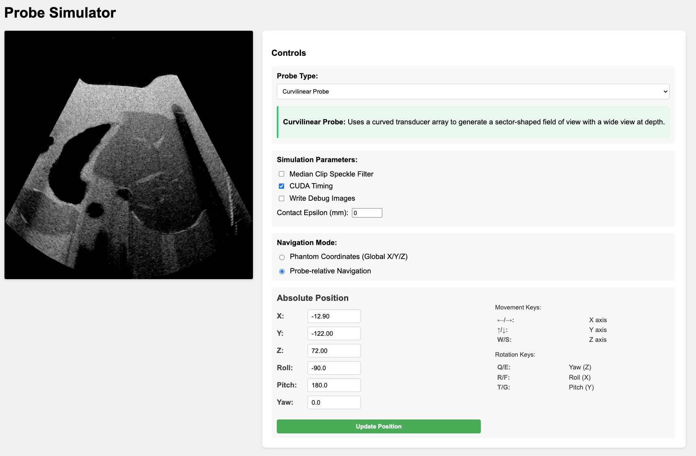

# Raytracing Ultrasound Simulator

A high-performance GPU-accelerated ultrasound simulator using NVIDIA OptiX raytracing.

The simulator implements the straight-ray approach of [Bürger et al. (2013), IEEE Transactions on Medical Imaging](https://pubmed.ncbi.nlm.nih.gov/23268382/): plausible, real-time B-mode images from labeled surface meshes, well suited to sim-to-real robotics perception and ML data generation. Wave effects such as diffraction, interference, and phase are not modeled — see [capabilities and limitations](./docs/ultrasound_simulator_technical_guide.md#14-what-the-ray-model-does-and-does-not-capture) before relying on it for quantitative acoustics or signal-processing work.

## Features

- GPU acceleration with CUDA and NVIDIA OptiX
- Python interface for ease of use
- Real-time simulation capabilities
- Support for curvilinear, linear, phased array, and radial ultrasound probe simulation

## Requirements

- [CUDA 13](https://docs.nvidia.com/cuda/cuda-quick-start-guide/index.html#) and [NVIDIA Driver 580+](https://www.nvidia.com/en-us/drivers/)
  for GPUs of compute capability 7.5 through 12.1 (Turing to Blackwell, including DGX Spark GB10 and DGX Station GB300).
  CUDA 12.6+ with driver 555+ is only for pre-Turing GPUs or hosts that cannot run driver 580; it cannot build for
  Blackwell (see [Building with Docker](docs/docker_build.md)).
- [CMake 3.24+](https://cmake.org/)
- [NVIDIA OptiX SDK 8.1](https://developer.nvidia.com/designworks/optix/downloads/legacy)

## Quick start

### Option 1: Using build_and_run.sh

```bash
cd ultrasound-simulator
./build_and_run.sh examples/server.py
```

Open `http://localhost:8000` for the web server.

The radial IVUS/R-EBUS geometry check and benchmark needs no mesh assets and runs the same way:
`./build_and_run.sh examples/radial_probe_benchmark.py`.



### Option 2: Docker

Instructions to build and run the examples in a docker environment can be found in the [`docs/docker_build`](docs/docker_build.md).

### Option 3: Bare-Metal Installation

Instructions to build and run the examples on a bare-metal installation can be found in the [`docs/baremetal_build`](docs/baremetal_build.md).

## Start Simulating

For a comprehensive guide on using the simulator, understanding its features, and exploring advanced topics, please refer to our documentation:

- **[Getting Started Guide](./docs/ultrasound_simulator_getting_started.md)**: A step-by-step tutorial for beginners.
- **[Technical Guide](./docs/ultrasound_simulator_technical_guide.md)**: An in-depth look at the physics and implementation details.

## Radial IVUS and R-EBUS geometry

`RadialProbe` models the rotating, single-element geometry used for IVUS and R-EBUS. It acquires
$N$ A-lines over one full turn. In the probe's local frame, `+y` follows the catheter axis and
A-line zero points along `+z`; `Pose` then places that frame in the scene.

For A-line $i \in \{0, \ldots, N-1\}$,

$$
\begin{aligned}
\theta_i &= \theta_0 + s\,\frac{2\pi i}{N}, \\
\mathbf{o}_i &= r_o(\sin\theta_i,\ 0,\ \cos\theta_i), \\
\mathbf{d}_i &=
(\cos\beta\sin\theta_i,\ \sin\beta,\ \cos\beta\cos\theta_i).
\end{aligned}
$$

Here, $\theta_0$ is the start angle, $s$ is `+1` or `-1` for the acquisition direction,
$r_o$ is `transducer_offset_radius`, and $\beta$ is `beam_tilt`. Positive rotation runs from
`+z` towards `+x`; negative rotation reverses the order. The half-open sequence covers the full
turn without acquiring the seam twice. The equations use radians, while the API accepts angles in
degrees.

```python
import ultrasound_simulator.cuda as rs

probe = rs.RadialProbe(
    num_scanlines=512,
    dead_zone_radius=0.75,
    rotation_period=1.0 / 30.0,
    transducer_offset_radius=0.2,
    beam_tilt=5.0,
    rotation_direction=rs.RadialRotationDirection.NEGATIVE,
)
```

Distances are in millimetres and `rotation_period` is in seconds. Setting $r_o=\beta=0$ gives a
centred, transverse sweep.

Scan conversion maps each output point $(x,z)$ into catheter-centred polar coordinates:

$$
\begin{aligned}
r &= \sqrt{x^2+z^2}, &
\phi &= \operatorname{atan2}(x,z), \\
u_r &= \frac{r}{R}, &
u_\theta &= \operatorname{wrap}
\left(s\,\frac{\phi-\theta_0}{2\pi}\right),
\end{aligned}
$$

where $R$ is the maximum imaging range and
$\operatorname{wrap}(q)=q-\lfloor q\rfloor$. Pixels are sampled only when
$r_d \le r \le R$, with $r_d$ set by `dead_zone_radius`; this produces the central cut-out.
Angular interpolation is periodic across the seam.

For an eccentric or tilted emitter, range is measured from $\mathbf{o}_i$ along
$\mathbf{d}_i$, while the image remains centred on the catheter axis. Scan conversion deliberately
leaves that mismatch visible rather than correcting it, preserving the resulting geometric
distortion.

For a rotation period $T$, the acquisition timestamp is

$$
t_i = T\frac{i}{N}.
$$

The final A-line therefore occurs before $T$, consistently with the half-open turn. These
timestamps describe acquisition order; they do not advance scene motion automatically.

The offset-and-tilt model follows published treatments of
[IVUS geometric artefacts](https://pubmed.ncbi.nlm.nih.gov/10386732/) and
[R-EBUS simulation geometry](https://pmc.ncbi.nlm.nih.gov/articles/PMC9927880/). Its parameters
describe generic mechanics rather than calibration data for a particular catheter.

## Benchmark Results

### General benchmark

To reproduce these results, run `python examples/benchmark.py`.

```text
Benchmark Results:
        Total frames: 200
        Average frame time: 0.0015 seconds
        Average FPS: 665.09
        Minimum FPS: 249.41
        Maximum FPS: 1500.11
        Date: 2026-10-14 22:21:19

        System Information:
        GPU: NVIDIA GB300 (250.7 GB, Driver: 610.43.02)
        CPU: Neoverse-V2 (72 cores)

```

### Radial benchmark

For the radial probe, run `python examples/radial_probe_benchmark.py`. The self-contained benchmark
uses four overlapping spheres to form centred and asymmetric reflector shells, allowing each
detected range to be checked against an analytic ray-sphere intersection. It tests both acquisition
directions and reports geometric error, seam continuity, timestamp accuracy, end-to-end latency,
A-line throughput and returned payload size. The timed call includes all returned data and writes no
images or other artefacts.
